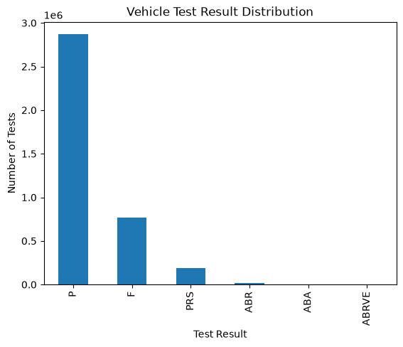
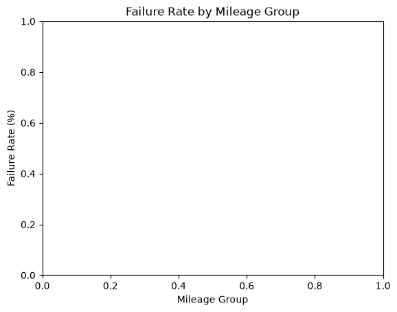
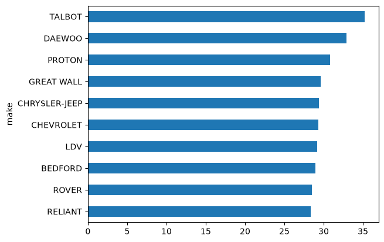
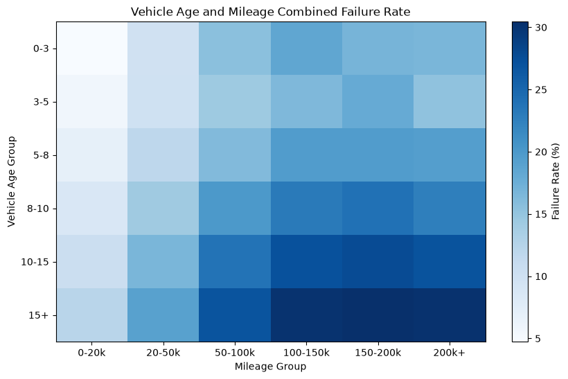

# Commercial Vehicle Reliability & Failure Pattern Analysis

## Project Overview

Commercial vehicle reliability is important for maintaining vehicle availability and supporting effective maintenance planning. Vehicle failures can be associated with factors such as vehicle age, mileage, vehicle class, make, fuel type, engine capacity, and recorded defects.

This project uses Python-based data analysis to explore commercial vehicle test results and identify failure patterns across different vehicle characteristics and failure-related factors.

The analysis focuses on understanding how vehicle age and mileage relate to failure rates and identifying important patterns across vehicle categories and recorded defects.

---

## Problem Statement

Vehicle failures can affect fleet reliability and maintenance planning. Analysing failures using only a single factor such as vehicle age, mileage, or failure type may not provide a complete view of failure patterns.

This project analyses multiple vehicle and test-related factors together to understand patterns associated with MOT test failures.

The analysis can help identify higher-failure groups and commonly recorded defect patterns that can support more informed maintenance planning.

---

## Project Objectives

The main objectives of this project are:

- Analyse MOT test result patterns.
- Examine how vehicle mileage is associated with failure rates.
- Examine how vehicle age is associated with failure rates.
- Compare failure rates across vehicle characteristics such as make, fuel type, vehicle class, test type, and engine capacity.
- Analyse recorded failure items, dangerous marks, defect locations, and defect categories.
- Examine the combined effect of vehicle age and mileage on failure rates.

---

## Proposed Solution

The project uses Python, Pandas, NumPy, and Matplotlib to clean, transform, analyse, and visualize MOT test data.

The analysis is used to identify failure patterns across different vehicle characteristics and to understand which vehicle groups and defect categories show higher failure rates.

The project follows this workflow:

**Industry Selection → Problem Identification → Dataset Collection → Data Cleaning → Data Transformation → Data Analysis → Data Visualization → Insights → Recommendations**

---

## Analysis Questions

The project aims to answer questions such as:

1. How does vehicle mileage relate to MOT failure rates?
2. How does vehicle age relate to MOT failure rates?
3. How do failure rates vary across different vehicle makes?
4. How do fuel type, vehicle class, test type, and engine capacity relate to failure rates?
5. What are the most frequently recorded vehicle defects?
6. How do vehicle age and mileage together relate to failure rates?

---

## Dataset Information

### Dataset Name

**UK DVSA Anonymised MOT Results**

### Dataset Source

The dataset is provided by the UK Driver and Vehicle Standards Agency (DVSA) through the UK government's open data resource.

The dataset contains anonymised MOT test results and related vehicle information, including vehicle make, model, odometer reading, test result, and failure-related information.

### Dataset Structure

The cleaned test-result dataset used for the analysis contains:

- **Rows:** 3,848,518
- **Columns:** 15
- **File Format:** CSV

### Important Features

The main columns used in the analysis include:

- `test_id`
- `vehicle_id`
- `test_date`
- `test_class_id`
- `test_type`
- `test_result`
- `test_mileage`
- `postcode_area`
- `make`
- `model`
- `colour`
- `fuel_type`
- `cylinder_capacity`
- `first_use_date`
- `completed_date`

A separate failure-item dataset was also analysed for failure-related information such as failure type, dangerous marks, defect locations, and completed dates.

---

## Tools & Technologies

- Python
- Jupyter Notebook
- NumPy
- Pandas
- Matplotlib

---

## Data Collection & Understanding

The project uses anonymised MOT test data provided through the UK DVSA open data resource.

The initial dataset contained **6,140,803 records and 15 columns** before cleaning.

During the data understanding stage, the following aspects were examined:

- Dataset shape
- Column names
- Data types
- Test result distribution
- Mileage information
- Vehicle characteristics
- Date fields
- Failure-related information

The cleaned test-result dataset contains **3,848,518 records and 15 columns**.

---

## Data Cleaning & Transformation

The following data preparation steps were performed:

- Removed invalid/header-like records from the dataset.
- Converted `test_date` into datetime format.
- Converted `first_use_date` into datetime format.
- Converted `completed_date` into datetime format.
- Converted `test_mileage` into numeric format.
- Converted `cylinder_capacity` into numeric format.
- Removed duplicate records.
- Reset the dataframe index.
- Created vehicle age from test date and first-use date.
- Created vehicle age groups.
- Created mileage groups.
- Used the cleaned dataset for further analysis.

---

## Exploratory Data Analysis

The project performed the following analyses:

### 1. Test Result Distribution

The distribution of MOT test results was analysed to understand the overall test outcome pattern.

The cleaned dataset contains the following test-result counts:

| Test Result | Count |
|---|---:|
| P | 2,869,955 |
| F | 769,928 |
| PRS | 184,917 |
| ABR | 21,152 |
| ABA | 2,565 |
| ABRVE | 1 |

---

### 2. Mileage vs Failure Rate

Failure rates were analysed across different mileage groups.

| Mileage Group | Failure Rate |
|---|---:|
| 0–20k | 6.50% |
| 20–50k | 12.53% |
| 50–100k | 21.27% |
| 100–150k | 26.95% |
| 150–200k | 28.16% |
| 200k+ | 27.29% |

The analysis shows an overall increase in failure rate as mileage increases, with the highest observed rate in the 150–200k mileage group.

---

### 3. Vehicle Age vs Failure Rate

Failure rates were analysed across vehicle age groups.

| Vehicle Age | Failure Rate |
|---|---:|
| 0–3 years | 9.03% |
| 3–5 years | 9.96% |
| 5–8 years | 14.18% |
| 8–10 years | 19.23% |
| 10–15 years | 24.32% |
| 15+ years | 27.84% |

The analysis shows that failure rates generally increase across the vehicle age groups.

---

### 4. Make-wise Failure Analysis

Failure rates were compared across vehicle makes.

Among the analysed makes, the highest observed failure rates included:

- TALBOT – 35.24%
- DAEWOO – 32.88%
- PROTON – 30.85%
- GREAT WALL – 29.63%
- CHRYSLER-JEEP – 29.43%

The comparison highlights differences in observed failure rates across vehicle makes.

---

### 5. Fuel Type Analysis

Failure rates were compared across different fuel types.

The analysis showed variation in failure rates across fuel categories, with LP, DI, and PE showing higher observed rates among the analysed categories.

---

### 6. Vehicle Class Analysis

Failure rates were compared across MOT vehicle classes.

Vehicle Class 7 showed a higher observed failure rate than the other analysed vehicle classes.

---

### 7. Test Type Analysis

The project compared failure rates between different test types.

The analysis showed a substantial difference between NT and RT test results, with NT tests having a much higher observed failure rate.

---

### 8. Engine Capacity Analysis

Failure rates were analysed across engine-capacity groups.

The observed failure rates varied across engine-capacity ranges, with the 2001–3000 group showing a higher rate than several other groups.

---

## Failure Item Analysis

A separate failure-item dataset was analysed to understand recorded defects.

The analysis included:

- Failure item type
- Dangerous marks
- Defect location
- Defect category
- Frequently recorded defects
- Dangerous failures by failure type

The failure-item dataset contained **10,451,564 records and 6 columns**.

The most frequently recorded defects included:

- Tread depth below requirements of 1.6mm
- Seriously weakened components
- Excessively worn pin/bush
- Less than 1.5mm thick
- Tyre tear due to separation/partial failure
- Excessively corroded components
- Non-working components
- Excessively worn ball joints
- Excessive engine leakage
- Corroded or seriously weakened components

---

## Combined Age & Mileage Analysis

The project also analysed vehicle age and mileage together to identify combined failure patterns.

The analysis showed that higher vehicle age combined with higher mileage generally corresponded to higher observed failure rates.

The highest observed failure rates were concentrated in the older age groups and higher mileage groups.

This combined analysis provides a broader view than analysing vehicle age or mileage independently.

---

## Key Insights

Based on the actual analysis:

- MOT failure rates generally increase as vehicle mileage increases.
- MOT failure rates generally increase with vehicle age.
- Failure rates vary across vehicle makes.
- Failure rates vary across fuel types and vehicle classes.
- Vehicle Class 7 showed a higher observed failure rate than the other analysed classes.
- Different engine-capacity groups showed different failure rates.
- Tyre, wear, corrosion, and structural/component-related defects were among the frequently recorded failure items.
- Combined age and mileage analysis showed higher observed failure rates for older vehicles with higher mileage.
- The results identify associations and patterns in the dataset; they do not establish that a particular factor directly causes vehicle failure.

---

## Recommendations

Based on the observed patterns:

- Maintenance planning can give greater attention to older and higher-mileage vehicles.
- Fleet operators can monitor frequently occurring defect categories during maintenance planning.
- Vehicles showing combinations of higher age and mileage can be considered for closer inspection.
- Failure patterns across vehicle classes, makes, and fuel types can be monitored to support maintenance prioritization.
- Historical MOT failure patterns can be used as a supporting source for reliability and maintenance analysis.

---

## Visualizations

The project created the following visualizations using Matplotlib:

### Test Result Distribution



**Purpose:** To understand the distribution of MOT test outcomes.

**Key Insight:** Passed tests form the largest group, while failed tests represent a substantial portion of the analysed test results.

---

### Failure Rate by Mileage



**Purpose:** To examine how failure rates vary across mileage groups.

**Key Insight:** Failure rates generally increase as mileage increases, with the highest observed rate in the 150–200k group.

---

### Make-wise Failure Rate



**Purpose:** To compare observed failure rates across vehicle makes.

**Key Insight:** Failure rates vary considerably across the analysed vehicle makes.

---

### Vehicle Age and Mileage Combined Failure Rate



**Purpose:** To examine failure rates across combinations of vehicle age and mileage.

**Key Insight:** Older vehicles combined with higher mileage generally show higher observed failure rates.

---

## Project Structure

```text
Commercial Vehicle Reliability & Failure Pattern Analysis/
│
├── README.md
│
├── datasets/
│   ├── raw_dataset.csv/
│   │   ├── test_result_202401.csv
│   │   ├── test_result_202402.csv
│   │   ├── ...
│   │   └── test_result_202412.csv
│   │
│   └── cleaned_datasets.csv/
│       └── cleaned_dataset.csv
│
├── Notebook/
│   └── Commercial_Vehicle_Reliability_Failure_Pattern_Analysis.ipynb
│
├── Python/
│   ├── data_loading.py
│   ├── data_cleaning.py
│   ├── exploratory_analysis.py
│   └── data_visualization.py
│
├── Visualizations/
│   ├── distribution_analysis.png
│   ├── trend_analysis.png
│   ├── category_analysis.png
│   └── correlation_analysis.png
│
└── Documentation/
    └── Project_Report.pdfs